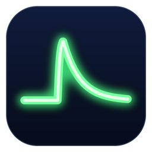
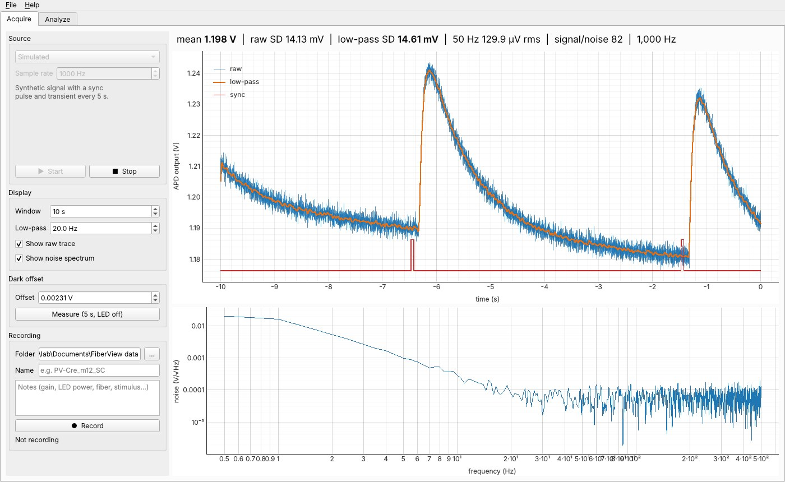
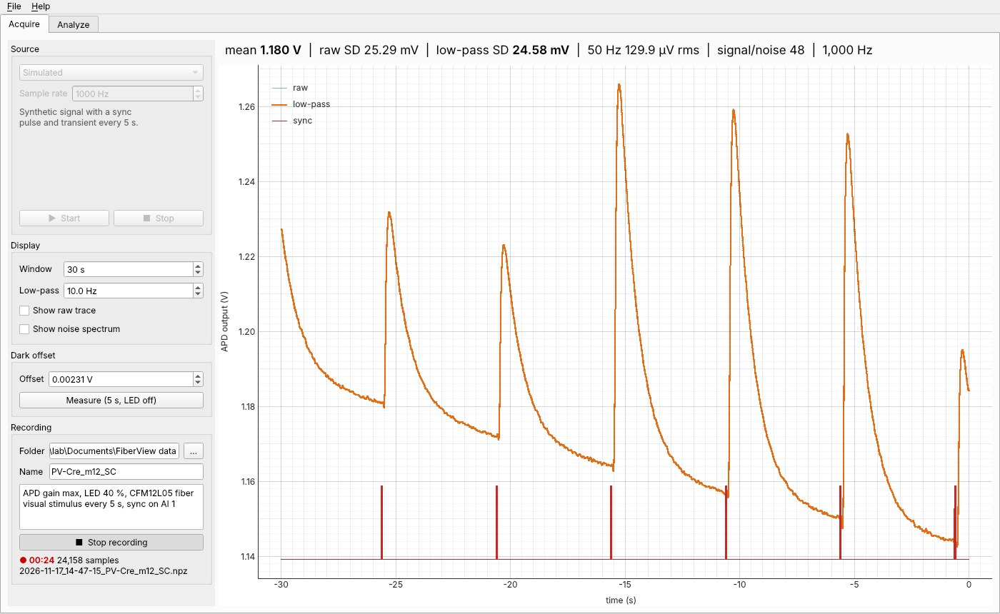
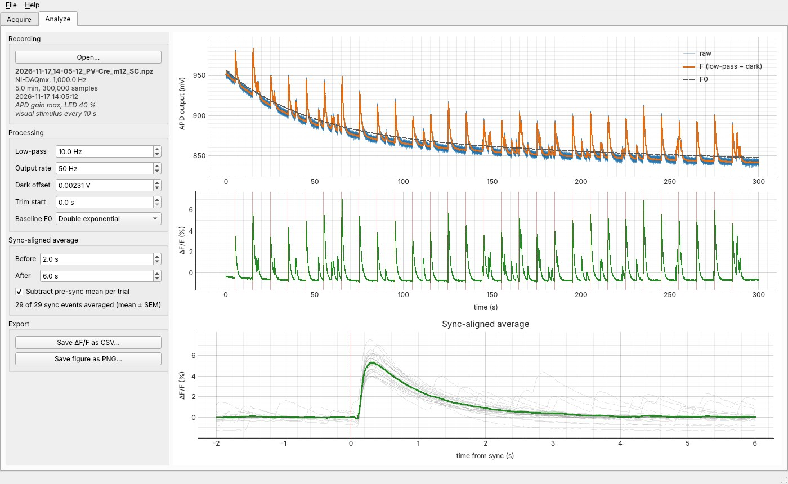
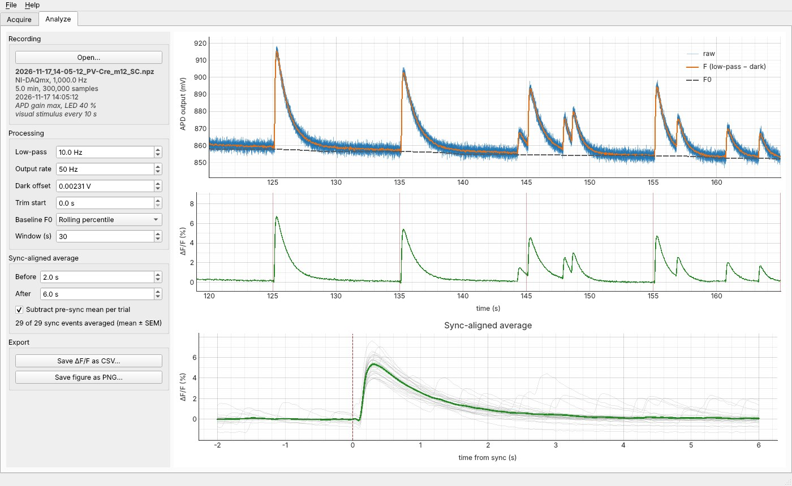

<p align="center"></p>

# FiberView – fiber photometry acquisition and analysis

FiberView records the output of a photodetector (e.g. Thorlabs APD440A2) with an **NI-DAQmx device**
(USB-6229, PCIe-6251, USB-6002…) or a low-cost **Arduino + ADS1115**, shows the signal and its noise live,
and turns recordings into ΔF/F with a sync-aligned average.

- **Acquire:** live trace and low-pass trace, noise spectrum, mean / raw SD / low-pass SD / 50 Hz pickup /
  signal-to-noise, saturation warning, dark-offset measurement, recording to `.npz` (streamed to disk, so a
  crash loses nothing), optional TTL sync input. A **Simulated** source lets you try everything without hardware.
- **Analyze:** low-pass and resampling, dark-offset subtraction, bleaching baseline (double exponential,
  polynomial or rolling percentile), ΔF/F, sync pulses marked on the trace, sync-aligned average (single trials,
  mean ± SEM), export to CSV and PNG. Also opens `.npy` files from the older `apd_live_view.py`.

## Screenshots









*Screenshots are made from the app itself with simulated data: `python install/make_screenshots.py`.*

## Install

Download the installer for your computer from the
[latest release](https://github.com/jerjely/FiberView/releases/latest). No Python needed.

| Computer | File |
|---|---|
| Windows 10/11 (64-bit) | `FiberView-<version>-Windows-setup.exe` |
| Mac with Apple silicon (M1–M4) | `FiberView-<version>-macOS-AppleSilicon.pkg` |
| Mac with Intel processor | `FiberView-<version>-macOS-Intel.pkg` |
| Arduino + ADS1115 DAQ (optional) | `FiberView-<version>-Arduino.zip` |

- **Windows** installs for the current user only (no admin rights) into `%LOCALAPPDATA%\Programs\FiberView`,
  with a Start menu entry and an optional desktop shortcut. Uninstall from *Settings → Apps*.
- **Mac** installs **FiberView.app** into Applications.
- The installers are **not code-signed**. Windows: "Windows protected your PC" → **More info → Run anyway**.
  Mac: **System Settings → Privacy & Security → Open Anyway** (or right-click the .pkg → Open).
- **Help → About** shows the installed version. Installing a newer version over an older one keeps your
  settings and recordings.

### Install alongside (not included in the installers)

| You use | Also install |
|---|---|
| An NI device | The **NI-DAQmx driver** from [ni.com](https://www.ni.com/en/support/downloads/drivers/download.ni-daq-mx.html) (Windows; comes with NI MAX). Close the NI MAX Test Panel before starting FiberView. |
| Arduino + ADS1115 | The **Arduino IDE** and the *Adafruit ADS1X15* library, to upload the sketch once (see [arduino/README.md](arduino/README.md)). |

Without them FiberView still runs: the Simulated source, the Arduino source and the Analyze tab work.
NI-DAQmx is Windows/Linux only, so on a Mac use the Arduino or analyse recordings made elsewhere.

## Wiring

**NI device (differential):** APD BNC center → AI 0 (terminal 1 on a USB-6229 screw-terminal), shield → AI 8
(terminal 2) and AI GND (terminal 3). FiberView: *Input Differential, ±5 V, 10 kHz*. Optional sync TTL on
another AI channel (e.g. AI 1), recorded single-ended.

**Arduino + ADS1115:** see [arduino/README.md](arduino/README.md).

Measure the **dark offset** (LED off, gain at the recording setting) before recording; it is saved with every
recording and subtracted in Analyze. Measure it again after changing the APD gain.

## Recording format

```python
import json, numpy as np
d = np.load("2026-11-17_14-00-00_mouse1.npz")
t, v, fs = d["time"], d["signal"], float(d["fs"])        # seconds, volts, Hz
sync = d["sync"] if "sync" in d else None
meta = json.loads(str(d["meta"]))                         # source, settings, dark_offset_V, notes, times
```

If FiberView crashed during a recording, open the `.meta.json` file next to it in Analyze to recover the data.

## Install from source (development)

Needs Python 3.9+.

- **Windows:** double-click `install_windows.bat` (private environment in `%LOCALAPPDATA%\FiberView`,
  Desktop + Start menu shortcuts). `open_fiberview.bat` starts it, `uninstall_windows.bat` removes it.
- **Mac:** double-click `install_mac.command` (environment in `.venv` in this folder); run it again to start.
- **Any system:**
  ```
  python -m venv .venv
  .venv/bin/pip install -r requirements.txt        (Windows: .venv\Scripts\pip ...)
  .venv/bin/python fiberview.py
  ```

Self-test on synthetic data (processing, files, Arduino parser and the whole GUI, offscreen):

```
python fiberview.py --self-test [logfile]       # exit code 0 = all passed
```

## Making a release

1. Commit and push your changes (GitHub Desktop: *Commit to main → Push origin*).
2. Either
   - **tag it:** GitHub Desktop → *History* → right-click the commit → *Create Tag…* → `v1.0.0` → *Push origin*, or
   - **on github.com:** *Actions → Build installers → Run workflow*, type `1.0.0` in the *version* box →
     *Run workflow* (the workflow creates the tag `v1.0.0` itself).
3. After about 15 minutes the release with the three installers and the Arduino zip appears under **Releases**.

*Run workflow* with the version box **empty** only builds and tests; the installers are then downloadable
under *Artifacts* on that run's page, and no release or tag is made.

Each build (Windows, Apple silicon Mac on `macos-15`, Intel Mac on `macos-15-intel`) builds the app with
PyInstaller (`install/fiberview.spec`), runs its self-test, builds the installer (`install/windows_installer.iss`,
Inno Setup; `install/make_pkg.sh`, pkgbuild), installs it on the build machine and runs the self-test again.
Only if all of that passes is the release published (`.github/workflows/build-installers.yml`). The version
comes from the tag (`install/ci_version.py` writes `fv_version.py`). To redraw the icon:
`python install/make_icon.py`.

## License

MIT © Gergely Szarka, University of Pécs – see [LICENSE](LICENSE).
